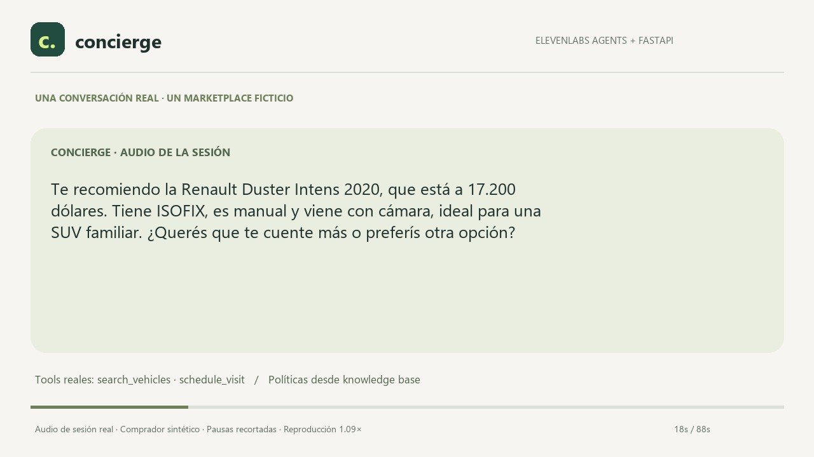
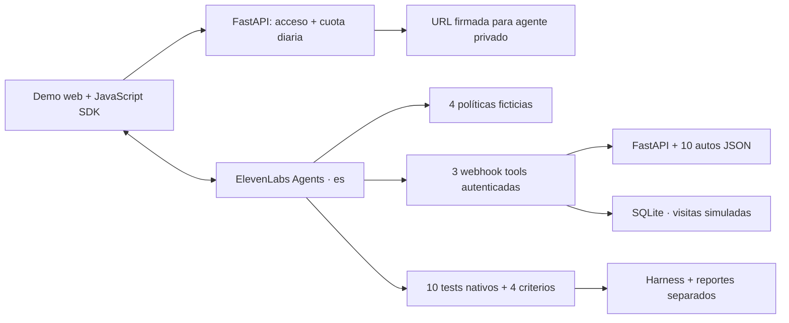

# Concierge · voz para encontrar tu próximo auto

Construí Concierge para explorar una pregunta concreta: ¿puedo buscar un auto conversando, sin perder la precisión de los filtros de un catálogo?

Cuando busco un usado, no pienso primero en campos de un formulario. Pienso en lo que necesito: «Tengo hasta 15.000 dólares, quiero un automático y necesito ISOFIX». Quise llevar esa forma de buscar a una demo de voz, con una condición: que el agente consulte los datos antes de recomendar y reconozca cuando no encuentra una opción.

Mi solución combina **ElevenLabs Agents + FastAPI** con un inventario de diez autos **100% ficticios**. El agente consulta precio y equipamiento, responde sobre cuatro políticas de ejemplo y puede agendar una visita simulada después de pedir confirmación. Escribí las instrucciones con voseo; usé la voz multilingüe Sarah, sin atribuirle un acento argentino.

Armé este proyecto como una demo de portfolio. Los autos y las políticas los creé para el ejercicio; no son datos de clientes ni de una empresa. En [cómo lo pensé](docs/case-study.md) cuento las decisiones, lo que probé y lo que todavía falta.

[](docs/media/demo.mp4)

[Video con audio y subtítulos](docs/media/demo.mp4). El comprador usa voz sintética; las respuestas provienen de una sesión real de ElevenLabs Agents. Se recortan pausas y se indica la velocidad de reproducción en pantalla para mantener el video por debajo de 90 segundos, sin inventar respuestas. No se usa un micrófono personal. Ver [procedencia del video](docs/media/demo.json).

## Probar localmente, sin cuenta de ElevenLabs

Requiere Python 3.11+; probado con Python 3.13. Los siguientes comandos usan una terminal compatible con tu sistema:

```sh
git clone https://github.com/ImSherlocked27/concierge-voz-autos.git
cd concierge-voz-autos
python -m venv .venv
# Windows PowerShell: .\.venv\Scripts\Activate.ps1
# macOS/Linux: source .venv/bin/activate
python -m pip install -e ".[dev]"
python -m uvicorn inventory.app:app --reload
```

Abrí [localhost:8000](http://localhost:8000): explorá el catálogo y combiná presupuesto, carrocería y equipamiento. El catálogo funciona sin credenciales. La página informa si la voz todavía no está configurada; no simula respuestas de ElevenLabs.

Para la voz se necesita una cuenta propia de ElevenLabs con créditos y el backend accesible desde Internet. El repositorio no incluye una API key ni un agente público sin límites.

## Arquitectura



- `search_vehicles`: filtra por presupuesto máximo en USD, carrocería y equipamiento; devuelve hasta tres resultados y nunca relaja filtros automáticamente.
- `get_vehicle`: devuelve un vehículo conocido o 404.
- `schedule_visit`: valida zona horaria, horario, confirmación, conflictos e idempotencia. No toma datos personales ni envía mensajes.
- Las políticas no prometen financiación ni garantías reales; todo está expresamente marcado como ficticio.

## Activar ElevenLabs

1. Copiá `.env.example` a `.env`. Nunca pegues la clave en código o en un issue.
2. Conectá la cuenta con el onboarding oficial (Node.js 24 / CLI 1.11.0 usados en esta demo):

   ```sh
   npx -y @elevenlabs/cli@1.11.0 onboard init
   ```

   Seguí las instrucciones que imprime. El onboarding guarda la clave localmente. `onboard check --env-path .env` verifica la integración sin imprimirla. Las pruebas de audio consumen créditos.

3. Seleccioná una voz **ya agregada a tu cuenta**. Para esta demo usé Sarah (`EXAVITQu4vr4xnSDxMaL`), que habla español con el modelo multilingüe. El voseo viene de las instrucciones del agente; no presento la voz como rioplatense ni necesito ampliar permisos para agregar otra.
4. Publicá el backend en un host que ejecute Python o Docker, con HTTPS y almacenamiento persistente. Para una prueba temporal también sirve `cloudflared tunnel --url http://localhost:8000`. Una URL temporal deja de funcionar al cerrar el proceso y **no es un despliegue permanente**.
5. Prepará los ajustes locales sin mostrar secretos:

   ```sh
   python -m scripts.setup_local --api-base https://TU-HOST --voice-id TU_VOICE_ID
   ```

   Genera `TOOLS_SECRET` y `DEMO_ACCESS_CODE` si faltan. Copiá esas variables al host; la clave de ElevenLabs y el código nunca van al navegador automáticamente. Reiniciá FastAPI para recargar los ajustes.
6. Validá y creá los recursos:

   ```sh
   python -m scripts.configure
   python -m scripts.configure --apply
   ```

   El primer comando es offline. `--apply` verifica el backend autenticado, crea el secret, sube cuatro documentos, registra tres tools y diez tests, configura cuatro criterios de evaluación y crea un agente privado. Guarda IDs y configuraciones resueltas en `.local/`; se puede reintentar después de una falla sin recrear los recursos ya registrados.
7. Guardá el `AGENT_ID` que imprime en `.env` y en el host. Reiniciá el servidor, ingresá el código local de la demo en la página e iniciá la conversación. El navegador pide permiso de micrófono.

### Agente como código y CLI

Las fuentes auditables están en `agent_configs/`, `tool_configs/`, `test_configs/` y `kb/`. Los placeholders de las tools se resuelven durante el alta. `scripts.configure` materializa JSON nativos y registros CLI con IDs de **tu** cuenta; no son IDs de ejemplo que debas copiar.

Después de configurar:

```sh
python -m scripts.cli agents status
python -m scripts.cli agents push --dry-run
python -m scripts.cli agents push
python -m scripts.cli agents test TU_AGENT_ID
```

El wrapper carga `.env` y ejecuta la CLI oficial; no imprime la clave. Si usás `elevenlabs` directamente, necesitás su propia sesión (`elevenlabs auth login`) o `ELEVENLABS_API_KEY` en el entorno. No todos los comandos CLI cargan `.env` automáticamente.

## API y smoke tests

| Ruta | Autenticación | Resultado |
| --- | --- | --- |
| `GET /health` | Pública | Estado del servicio |
| `GET /api/catalog` | Pública | Catálogo ficticio completo para la página |
| `GET /api/config` | Pública | Disponibilidad de voz; sin IDs ni secretos |
| `POST /api/session` | Código de demo | URL firmada; reserva una sesión de la cuota |
| `GET /vehicles?max_price=22000&body=suv&feature=isofix` | `X-Tools-Secret` | Máximo tres SUVs dentro del presupuesto |
| `GET /vehicles/{vehicle_id}` | `X-Tools-Secret` | Auto conocido o 404 |
| `POST /visits` | `X-Tools-Secret` | Visita simulada confirmada o error explícito |

Los smoke tests reproducibles usan `httpx` dentro de pytest, sin tokens en argumentos de terminal:

```sh
python -m pytest -q
python -m scripts.configure
```

La suite verifica filtros, cero resultados, valores inválidos, 404, fallas de autenticación, consentimiento de agenda, idempotencia, conflictos concurrentes, cuota concurrente y métricas. No consume créditos ni llama a ElevenLabs.

## Tests nativos y métricas

Diez escenarios en cinco categorías: grounding, aclaración/alcance, tools, políticas y recorrido completo. Incluye **next reply**, **tool call** y **simulation**. El evaluador nativo valida la herramienta elegida y el harness verifica por separado los filtros exactos del JSON emitido, sin depender de rutas de parámetros sin documentar. La simulación usa herramientas contra el backend ficticio real y no inventa un éxito de agenda.

```sh
python -m scripts.evaluate --repeat 1
# Repetición probabilística; consume más créditos:
python -m scripts.evaluate --repeat 3
# Añadir conversaciones de audio consentidas para medir latencia:
python -m scripts.evaluate --export-only --conversation TU_CONVERSATION_ID
python -m evals.report
# Recalcular sin cuenta desde la evidencia pública sin mensajes ni credenciales:
python -m evals.report --input evals/evidence.json
# Prueba de voz real con comprador sintético; consume créditos:
python -m scripts.voice_smoke --run --hour 14 --minute 30
# Convertir la evidencia recién grabada a video:
python -m pip install -e ".[media]"
python -m scripts.render_demo
```

- [Reporte de suite nativa](evals/native-report.md): tasa de pase y estado de cada escenario.
- [Reporte de conversaciones](evals/report.md): p50/p95, denominadores explícitos, tool calls y criterios de éxito. Usa `convai_ttf_audio_since_silence.elapsed_time`, convertido de segundos a milisegundos: desde el silencio del usuario hasta el primer audio. Excluye el saludo y no mezcla simulaciones de texto con latencia de voz.
- [Evidencia pública recomputable](evals/evidence.json): resultados, tool names y métricas, sin mensajes, parámetros, encabezados ni metadatos de cuenta.
- `.local/` y `evals/raw/` están excluidos de Git. No publiques transcripts o audios de personas sin consentimiento.
- Un dato ausente se informa como **pendiente**. Los resultados de pytest no son métricas del agente.

## Límites de la demo

Agente privado, acceso por código, hasta 10 sesiones diarias, concurrencia de 2 y duración máxima de 180 segundos configurados también del lado de ElevenLabs. El contador local usa SQLite y reserva cupo antes de pedir una URL firmada; una falla externa puede consumir ese cupo local. Usá una sola instancia y un disco persistente para conservar la agenda y la cuota. El contador local se renueva por día UTC; el límite nativo de ElevenLabs es una protección adicional.

No hay inventario real, pagos, financiación, teléfono, dirección física, confirmaciones por correo ni integración con un empleador. Ver [decisiones y límites](docs/design.md) y [recorrido de demostración](docs/demo.md).

## Fuentes

Documentación consultada al implementar: [CLI](https://elevenlabs.io/docs/eleven-agents/operate/cli), [webhook tools](https://elevenlabs.io/docs/eleven-agents/customization/tools/webhook-tools), [knowledge base](https://elevenlabs.io/docs/eleven-agents/customization/knowledge-base), [Agent Testing](https://elevenlabs.io/docs/eleven-agents/customization/agent-testing), [JavaScript SDK](https://elevenlabs.io/docs/eleven-agents/libraries/java-script), [conversation details](https://elevenlabs.io/docs/eleven-agents/api-reference/conversations/get). Los payloads se validan además contra el SDK Python fijado en `pyproject.toml`.

Licencia MIT.
